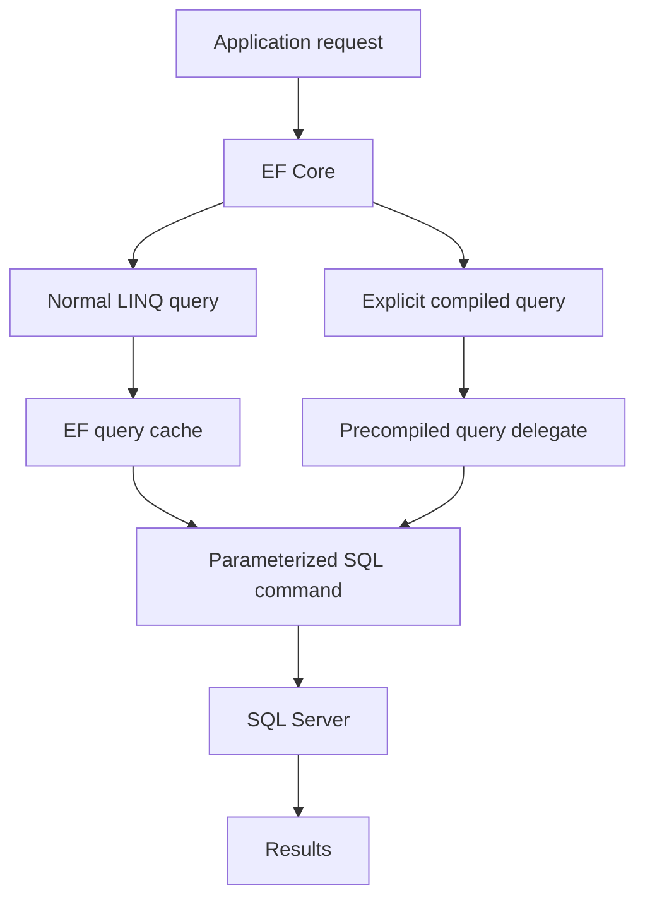

# EF Core Compiled Queries

**Compiled queries optimize EF overhead, not your entire database workload.**

This is a small Order API that shows when an explicit EF Core compiled query helps, when normal LINQ is already enough, and what you give up. It is meant to be read in a few minutes and then run.

.NET 10, C# 14, EF Core 10, SQL Server, ASP.NET Core, xUnit, BenchmarkDotNet, Swagger, structured logging.

## Start here

| If you want | Open |
|---|---|
| The normal and compiled queries | [OrderQueries.cs](src/EfCompiledQueries.Api/Queries/OrderQueries.cs) |
| Normal LINQ, and the fact that it is already cached | [01-NormalEfCoreQuery.cs](Examples/01-NormalEfCoreQuery.cs) |
| The automatic cache versus a compiled delegate | [02-EfCoreQueryCache.cs](Examples/02-EfCoreQueryCache.cs) |
| `EF.CompileQuery` | [03-ExplicitCompiledQuery.cs](Examples/03-ExplicitCompiledQuery.cs) |
| `EF.CompileAsyncQuery` and `await foreach` | [04-AsyncCompiledQuery.cs](Examples/04-AsyncCompiledQuery.cs) |
| Same result, three ways | [05-NormalVsCompiled.cs](Examples/05-NormalVsCompiled.cs) |

Normal LINQ is not recompiled from scratch on every call. EF Core caches the translation by query shape. A compiled query skips the per-call tree build and cache lookup. Both still send SQL to SQL Server every time. Neither caches the rows.

## The decision

| Scenario | Normal Query | Compiled Query | Likely Benefit | Recommendation |
|---|---|---|---|---|
| Occasional query | Usually sufficient | Possible | Low | Normal LINQ |
| Repeated hot path | Good baseline | Worth measuring | Potentially useful | Benchmark |
| Highly dynamic query | Flexible | Less suitable | Uncertain | Normal LINQ |
| Database-heavy query | Often sufficient | May help slightly | Often limited | Optimize SQL first |
| Simple fixed query | Good | Good candidate | Depends on workload | Measure |

### Architectural Takeaway

**Use compiled queries for measured hot paths, not as a default for every repository method.**

Compiled queries optimize EF-side query processing overhead, not your entire database workload.

The same table is executable in [11-PracticalDecisionGuide.cs](Examples/11-PracticalDecisionGuide.cs). More on the choice: [docs/Tradeoffs.md](docs/Tradeoffs.md).

## What happens to a request

Both paths produce a parameterized command. The compiled delegate does not skip SQL Server, and it does not skip command execution. "SQL command" here means the command that is sent, not a full LINQ recompile on every call.



SQL Server may reuse its own plan because the SQL is parameterized. That plan cache is not the EF query cache.

## Normal LINQ

[01-NormalEfCoreQuery.cs](Examples/01-NormalEfCoreQuery.cs) calls the query in `OrderQueries.NormalByIdAsync`:

```csharp
db.Orders
    .Where(order => order.Id == id)
    .Select(order => new OrderSummaryDto(
        order.Id,
        order.Customer.Name,
        order.TotalAmount,
        order.Status))
    .FirstOrDefaultAsync(cancellationToken);
```

The operators build a tree. SQL is sent when `FirstOrDefaultAsync` runs. The next call with another id reuses the cached translation of that shape.

## The automatic cache

[02-EfCoreQueryCache.cs](Examples/02-EfCoreQueryCache.cs) runs that shape twice with two ids.

- The parameter changes. The operators do not. That is one cache entry.
- A different `Where`, `Select`, or `Include` is a different entry.
- The cache stores a translation, not the result rows. Every execution still hits SQL Server.

## Explicit compiled queries

[03-ExplicitCompiledQuery.cs](Examples/03-ExplicitCompiledQuery.cs) calls the synchronous delegate. The expression uses `FirstOrDefault`. `FirstOrDefaultAsync` is not supported inside a compiled query.

```csharp
public static readonly Func<AppDbContext, int, OrderSummaryDto?> CompiledById =
    EF.CompileQuery((AppDbContext db, int id) =>
        db.Orders
            .Where(order => order.Id == id)
            .Select(order => new OrderSummaryDto(
                order.Id,
                order.Customer.Name,
                order.TotalAmount,
                order.Status))
            .FirstOrDefault());
```

The API does not block a request thread on that delegate. It uses the async form, `CompiledByIdAsync`, which is `EF.CompileAsyncQuery` with `FirstOrDefault` in the body and a `CancellationToken` parameter.

[04-AsyncCompiledQuery.cs](Examples/04-AsyncCompiledQuery.cs) reads the customer list. `CompileAsyncQuery` on an `IQueryable` returns `IAsyncEnumerable<OrderSummaryDto>`. Consume it with `await foreach`.

```csharp
await foreach (var order in OrderQueries.CompiledByCustomer(db, customerId).WithCancellation(cancellationToken))
{
    orders.Add(order);
}
```

Details and the mistakes that do not compile: [docs/CompiledQueriesGuide.md](docs/CompiledQueriesGuide.md).

## Examples

Each file has one idea, a `Takeaway`, and working code. The order lookup itself is not copied. It lives in `OrderQueries`.

| File | Idea |
|---|---|
| [01-NormalEfCoreQuery.cs](Examples/01-NormalEfCoreQuery.cs) | Normal LINQ, already cached by shape |
| [02-EfCoreQueryCache.cs](Examples/02-EfCoreQueryCache.cs) | Same shape, different ids, versus a compiled delegate |
| [03-ExplicitCompiledQuery.cs](Examples/03-ExplicitCompiledQuery.cs) | Synchronous `EF.CompileQuery` |
| [04-AsyncCompiledQuery.cs](Examples/04-AsyncCompiledQuery.cs) | Async sequence and `await foreach` |
| [05-NormalVsCompiled.cs](Examples/05-NormalVsCompiled.cs) | Same id, same result, three call styles |
| [06-HotPathVsColdPath.cs](Examples/06-HotPathVsColdPath.cs) | A hot lookup versus a rare admin report |
| [07-FixedVsDynamicQuery.cs](Examples/07-FixedVsDynamicQuery.cs) | A fixed delegate versus optional filters |
| [08-DatabaseCostVsEfOverhead.cs](Examples/08-DatabaseCostVsEfOverhead.cs) | A primary-key read versus an aggregate |
| [09-DtoProjectionVsEntityLoading.cs](Examples/09-DtoProjectionVsEntityLoading.cs) | Four columns versus the order graph |
| [10-RepeatedExecution.cs](Examples/10-RepeatedExecution.cs) | The same shape, many times, one context |
| [11-PracticalDecisionGuide.cs](Examples/11-PracticalDecisionGuide.cs) | When to measure, and when not to bother |

08 does not time the two queries. A single stopwatch call is not a result. Use the benchmark project.

## API

The controller only handles HTTP. `OrderService` logs and calls `OrderQueries`. Read models are `OrderSummaryDto`. A missing order or customer is 404. A customer with no orders is 200 and `[]`.

| Method | Path |
|---|---|
| GET | `/api/orders/{id}/normal` |
| GET | `/api/orders/{id}/compiled` |
| GET | `/api/customers/{customerId}/orders/normal` |
| GET | `/api/customers/{customerId}/orders/compiled` |
| GET | `/api/benchmark-info` |

Swagger UI: `http://localhost:5080/swagger`

On a fresh database the first customer is Ava Patel and the first order is hers, status `Paid`. The total depends on which path created the rows.

Small script sample (`scripts/SeedData.sql`), order 1:

```json
{
  "id": 1,
  "customerName": "Ava Patel",
  "totalAmount": 41.00,
  "status": "Paid"
}
```

Her orders:

```json
[
  { "id": 1, "customerName": "Ava Patel", "totalAmount": 41.00, "status": "Paid" },
  { "id": 2, "customerName": "Ava Patel", "totalAmount": 16.00, "status": "Shipped" }
]
```

Missing order:

```json
{
  "title": "Order not found",
  "status": 404,
  "detail": "No order exists with id 999999."
}
```

`/api/benchmark-info` describes the measurement. It does not contain timings. There are no fabricated numbers in this repository.

`dotnet run` on an empty database seeds 300 orders with a fixed random seed, so the rows are repeatable. Captured from that path:

```json
{
  "id": 1,
  "customerName": "Ava Patel",
  "totalAmount": 36.00,
  "status": "Paid"
}
```

The normal and compiled URLs returned the same JSON. Do not expect 41.00 unless you loaded `scripts/SeedData.sql` into an empty database and the API skipped its own seed because customers were already there.

To see the parameterized SQL, set `Microsoft.EntityFrameworkCore.Database.Command` to `Information`. It is `Warning` by default so startup seeding does not flood the console. Parameter values stay out of the log.

Requests are also listed in [EfCompiledQueries.Api.http](src/EfCompiledQueries.Api/EfCompiledQueries.Api.http).

Logs are JSON. The message templates (`{OrderId}`, `{QueryMode}`) are the structured fields. Parameter values are not logged.

## SQL Server

Local Windows authentication. The checked-in connection string has no password:

```text
Server=localhost;Database=EfCompiledQueries;Trusted_Connection=True;TrustServerCertificate=True;Encrypt=True
```

`TrustServerCertificate` is for a local instance whose certificate this machine does not trust. Do not copy that setting onto a server that has a real certificate.

Override without editing the file:

```powershell
$env:ConnectionStrings__Orders = "Server=localhost;Database=EfCompiledQueries;Trusted_Connection=True;TrustServerCertificate=True;Encrypt=True"
```

If you need SQL authentication, put the connection string in that environment variable or in user secrets. Do not commit a password.

The project was verified on SQL Server 2019 Developer Edition. It does not use syntax that exists only in SQL Server 2022. SQL Server 2019 or newer, including 2022, is enough.

Indexes, created by `AppDbContext`:

- `IX_Orders_CustomerId` for the customer list
- `IX_Orders_Status_OrderedAtUtc` for the cancelled-status filter and the date sort. The city comparison reads `Customers.City`
- `IX_OrderItems_ProductId` for the product-sales aggregate
- unique `Email` and `Sku`

Those indexes change database cost. A compiled query does not replace them.

### Create the database

Start the API. It calls `EnsureCreated` and seeds when `Customers` is empty.

```powershell
dotnet run --project src/EfCompiledQueries.Api
```

If you changed the model and the database already exists, `EnsureCreated` will not alter it. Drop it and start again:

```sql
DROP DATABASE EfCompiledQueries;
```

To load the four-row sample yourself:

```powershell
sqlcmd -S localhost -E -i scripts/SeedData.sql
```

Run that only against an empty `EfCompiledQueries`. If customers already exist, the script leaves them alone and the API will not add the 300-order set.

## Run the API

```powershell
dotnet run --project src/EfCompiledQueries.Api
```

Then open `http://localhost:5080/swagger`. The launch profile uses HTTP on port 5080.

## Run the tests

```powershell
dotnet test EFCore-CompiledQueries.sln -c Release
```

Tests use database `EfCompiledQueriesTests` on localhost with Windows authentication. They do not need a password. They check that normal and compiled queries return the same rows. They do not measure performance. They use SQL Server, not SQLite, so they do exercise SQL Server translation. They still say nothing about production latency.

The suite uses one web host. A compiled delegate is bound to the first EF model that executes it. A second model in the same process throws.

## Run the benchmarks

```powershell
dotnet run --project benchmarks/EfCompiledQueries.Benchmarks -c Release
```

First-execution sample, in its own process:

```powershell
dotnet run --project benchmarks/EfCompiledQueries.Benchmarks -c Release -- --filter *FirstExecution*
```

Release mode, warmup before the steady-state numbers, `MemoryDiagnoser`, SQL Server, same query and same id on both sides. The measured time includes SQL Server and the localhost round trip. It does not include HTTP. Read Mean, Error, StdDev, Allocated, and Op/s from the output of your run.

How to interpret that output, and what it cannot tell you: [docs/BenchmarkMethodology.md](docs/BenchmarkMethodology.md).

## Project structure

```text
EFCore-CompiledQueries/
├── README.md
├── EFCore-CompiledQueries.sln
├── Examples/
│   ├── 01-NormalEfCoreQuery.cs
│   ├── 02-EfCoreQueryCache.cs
│   ├── 03-ExplicitCompiledQuery.cs
│   ├── 04-AsyncCompiledQuery.cs
│   ├── 05-NormalVsCompiled.cs
│   ├── 06-HotPathVsColdPath.cs
│   ├── 07-FixedVsDynamicQuery.cs
│   ├── 08-DatabaseCostVsEfOverhead.cs
│   ├── 09-DtoProjectionVsEntityLoading.cs
│   ├── 10-RepeatedExecution.cs
│   └── 11-PracticalDecisionGuide.cs
├── src/EfCompiledQueries.Api/
│   ├── Controllers/OrdersController.cs
│   ├── Data/AppDbContext.cs
│   ├── Data/DatabaseSeeder.cs
│   ├── Queries/OrderQueries.cs
│   └── Services/OrderService.cs
├── tests/EfCompiledQueries.Tests/
├── benchmarks/EfCompiledQueries.Benchmarks/
├── docs/
└── scripts/SeedData.sql
```

`Examples/EfCompiledQueries.Examples.csproj` exists so those files compile. It is not a second copy of the queries.

## Tradeoffs

Use a compiled query when the shape is stable, the call is frequent, and a SQL Server benchmark shows that the EF portion matters.

Leave normal LINQ in place when the query is rare, the shape changes, or SQL Server is the cost. Fix the projection and the indexes before you reach for `EF.CompileQuery`.

The synchronous delegate blocks until SQL Server responds. Call the async delegate from ASP.NET Core.

Full checklist: [docs/Tradeoffs.md](docs/Tradeoffs.md).

**Use compiled queries for measured hot paths, not as a default for every repository method.**
